<!-- README-SVGS:START -->
<p align="center"><a href="https://icestore.hsinghhira.me/#stores"></a
><a href="https://icestore.hsinghhira.me/#zimaos">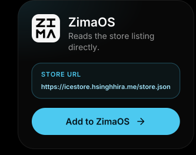</a
><a href="https://icestore.hsinghhira.me/#casaos">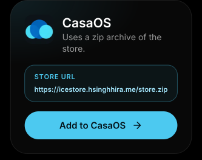</a
><a href="https://icestore.hsinghhira.me/#homeio">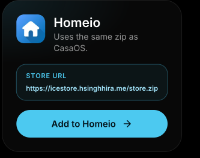</a
><a href="https://icestore.hsinghhira.me/#apps">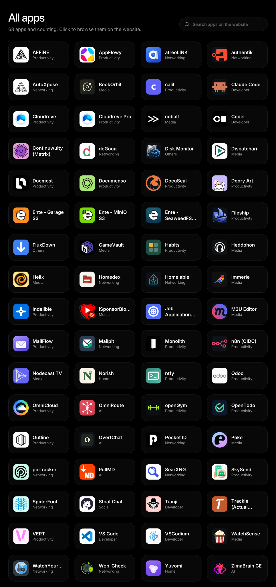</a
><a href="https://icestore.hsinghhira.me/app/affine/">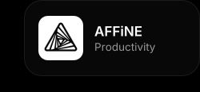</a
><a href="https://icestore.hsinghhira.me/app/appflowy/">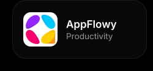</a
><a href="https://icestore.hsinghhira.me/app/authentik/">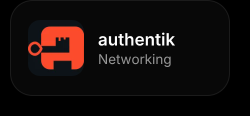</a
><a href="https://icestore.hsinghhira.me/app/autoxpose/">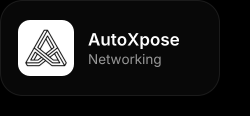</a
><a href="https://icestore.hsinghhira.me/app/bookorbit/">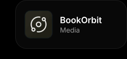</a
><a href="https://icestore.hsinghhira.me/app/claudecode/">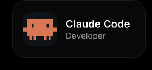</a
><a href="https://icestore.hsinghhira.me/app/cloudreve/">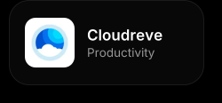</a
><a href="https://icestore.hsinghhira.me/app/cloudreve-pro/">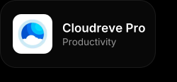</a
><a href="https://icestore.hsinghhira.me/app/cobalt/"></a
><a href="https://icestore.hsinghhira.me/app/coder/">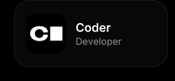</a
><a href="https://icestore.hsinghhira.me/app/continuwuity/">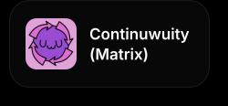</a
><a href="https://icestore.hsinghhira.me/app/degoog/"></a
><a href="https://icestore.hsinghhira.me/app/dispatcharr/">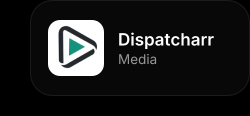</a
><a href="https://icestore.hsinghhira.me/app/docmost/">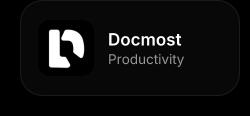</a
><a href="https://icestore.hsinghhira.me/app/documenso/">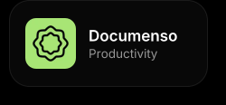</a
><a href="https://icestore.hsinghhira.me/app/docuseal/">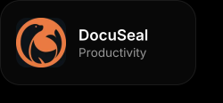</a
><a href="https://icestore.hsinghhira.me/app/doory-art/">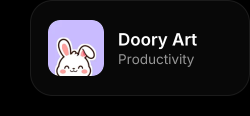</a
><a href="https://icestore.hsinghhira.me/app/ente-garage/">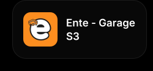</a
><a href="https://icestore.hsinghhira.me/app/ente-minio/">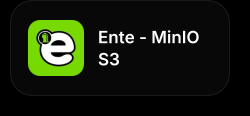</a
><a href="https://icestore.hsinghhira.me/app/ente-seaweedfs/">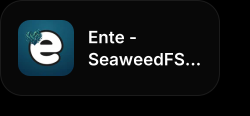</a
><a href="https://icestore.hsinghhira.me/app/fluxdown/"></a
><a href="https://icestore.hsinghhira.me/app/gamevault/">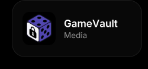</a
><a href="https://icestore.hsinghhira.me/app/helix/"></a
><a href="https://icestore.hsinghhira.me/app/homedex/">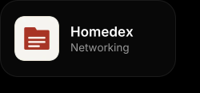</a
><a href="https://icestore.hsinghhira.me/app/homelable/">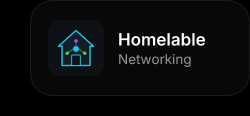</a
><a href="https://icestore.hsinghhira.me/app/immerle/">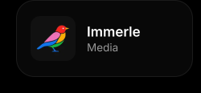</a
><a href="https://icestore.hsinghhira.me/app/indelible/">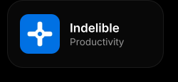</a
><a href="https://icestore.hsinghhira.me/app/m3u-editor/">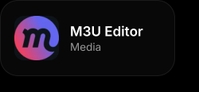</a
><a href="https://icestore.hsinghhira.me/app/mailpit/"></a
><a href="https://icestore.hsinghhira.me/app/n8n-oidc/">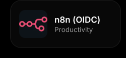</a
><a href="https://icestore.hsinghhira.me/app/nodecast-tv/">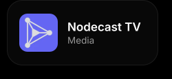</a
><a href="https://icestore.hsinghhira.me/app/ntfy/">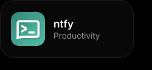</a
><a href="https://icestore.hsinghhira.me/app/odoo/">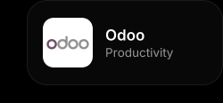</a
><a href="https://icestore.hsinghhira.me/app/omnicloud/">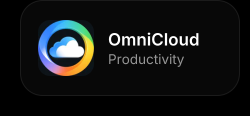</a
><a href="https://icestore.hsinghhira.me/app/omniroute/"></a
><a href="https://icestore.hsinghhira.me/app/opengym/">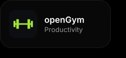</a
><a href="https://icestore.hsinghhira.me/app/outline/">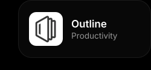</a
><a href="https://icestore.hsinghhira.me/app/pocket-id/">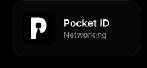</a
><a href="https://icestore.hsinghhira.me/app/portracker/">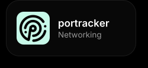</a
><a href="https://icestore.hsinghhira.me/app/searxng/">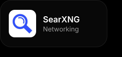</a
><a href="https://icestore.hsinghhira.me/app/skysend/">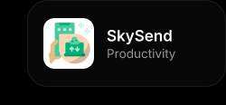</a
><a href="https://icestore.hsinghhira.me/app/spiderfoot/">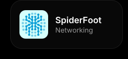</a
><a href="https://icestore.hsinghhira.me/app/stoatchat/"></a
><a href="https://icestore.hsinghhira.me/app/tianji/">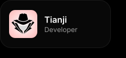</a
><a href="https://icestore.hsinghhira.me/app/trackie/"></a
><a href="https://icestore.hsinghhira.me/app/vert/">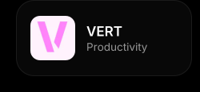</a
><a href="https://icestore.hsinghhira.me/app/vscode/">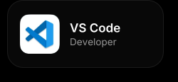</a
><a href="https://icestore.hsinghhira.me/app/vscodium/">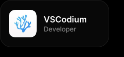</a
><a href="https://icestore.hsinghhira.me/app/watchyourlan/">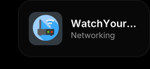</a
><a href="https://icestore.hsinghhira.me/app/web-check/">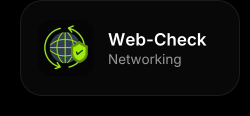</a
><a href="https://icestore.hsinghhira.me/app/yuvomi/"></a
><a href="https://icestore.hsinghhira.me/app/zimabrain-ce/">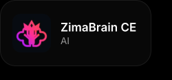</a
><a href="https://github.com/HSinghHira/IceStore/issues/new"></a
></p>
<!-- README-SVGS:END -->

# IceStore - Zima OS / Casa OS / Homeio Third Party Community App Store

A community app store for [ZimaOS](https://www.zimaspace.com/ZimaOS), [CasaOS](https://casaos.io/) and [Homeio](https://homeio.app/), maintained by [HSinghHira](https://github.com/HSinghHira).

Browse the apps at **[icestore.hsinghhira.me](https://icestore.hsinghhira.me/)**.

---

## 🟢 ZimaOS

ZimaOS reads app stores from a `store.json` manifest.

1. Open the **ZimaOS** dashboard.
2. Go to **App Store** → click the **⚙️ Community store**.
3. Click the ➕ icon.
4. Paste the URL below:

   ```text
   https://icestore.hsinghhira.me/store.json
   ```

5. Click **Add**, then refresh the App Store page.

> 💡 If the store doesn’t show up right away, try refreshing or restarting the App Store service — ZimaOS occasionally caches store sources.

Alternatively you can use Terminal command to add Store:

```sh
curl -s -X POST \
  -H "Authorization: $TOKEN" \
  -H 'Content-Type: application/json' \
  -d '{"url":"https://icestore.hsinghhira.me/store.json"}' \
  "http://localhost/v3/app_store/repo"
```

---

## 🟠 CasaOS

CasaOS doesn’t read `store.json` — instead, it can install a full custom app store from a **zip archive**.

1. Open the **CasaOS** dashboard.
2. Go to **App Store**.
3. Click **+ Add Source**.
4. Paste the store archive URL:

   ```text
   https://icestore.hsinghhira.me/store.zip
   ```

5. Click **Add**.

> 💡 If CasaOS rejects the source, use `latest.zip` instead of `store.zip`.

Alternatively you can use Terminal command to add Store:

```sh
sudo casaos-cli app-management register app-store https://icestore.hsinghhira.me/store.zip

sudo casaos-cli app-management list app-stores
```

---

## 🟣 Homeio

1. Open the **Homeio** dashboard.
2. Click **App Store**.
3. Click the **+ Install** button.
4. Go to **Manage Sources**.
5. Paste the store URL below:

   ```text
   https://icestore.hsinghhira.me/store.zip
   ```

6. Enter a name of your choice, e.g. “IceStore”.
7. Click the **Add Source** button.

> 💡 If Homeio rejects the source, use `latest.zip` instead of `store.zip`.

---

## 📦 Apps

Each app uses its own port in the 6101–6199 range. Multi-service apps like AFFiNE and AppFlowy are rebuilt as all-in-one images: the database, API, web app and workers run together in one container with one data folder, and secret keys are made on first start. Each app page on the [website](https://icestore.hsinghhira.me/) lists every setting you can add in the app settings. Click any app in the picture at the top to open its page.


---

## Support

Found a bug or want to request an app? Open an issue on the [IceStore GitHub repository](https://github.com/HSinghHira/IceStore/issues/new).
