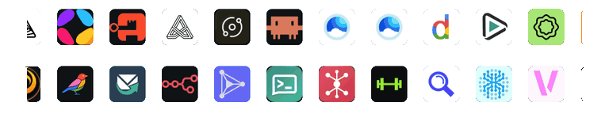

<center></center>

<center></center>

# IceStore - Zima OS / Casa OS / Homeio Third Party Community App Store

A community app store for [ZimaOS](https://www.zimaspace.com/ZimaOS), [CasaOS](https://casaos.io/) and [Homeio](https://homeio.app/), maintained by [HSinghHira](https://github.com/HSinghHira).

Browse the apps at **[icestore.hsinghhira.me](https://icestore.hsinghhira.me/)**.
---

## 🟢 ZimaOS

ZimaOS reads app stores from a `store.json` manifest.

1. Open the **ZimaOS** dashboard.
2. Go to **App Store** → click the **⚙️ Community store**.
3. Click the ➕ icon.
4. Paste the URL below:

   ```text
   https://icestore.hsinghhira.me/store.json
   ```

5. Click **Add**, then refresh the App Store page.

> 💡 If the store doesn’t show up right away, try refreshing or restarting the App Store service — ZimaOS occasionally caches store sources.

Alternatively you can use Terminal command to add Store:

```sh
curl -s -X POST \
  -H "Authorization: $TOKEN" \
  -H 'Content-Type: application/json' \
  -d '{"url":"https://icestore.hsinghhira.me/store.json"}' \
  "http://localhost/v3/app_store/repo"
```

---

## 🟠 CasaOS

CasaOS doesn’t read `store.json` — instead, it can install a full custom app store from a **zip archive**.

1. Open the **CasaOS** dashboard.
2. Go to **App Store**.
3. Click **+ Add Source**.
4. Paste the store archive URL:

   ```text
   https://icestore.hsinghhira.me/store.zip
   ```

5. Click **Add**.

> 💡 If CasaOS rejects the source, use `latest.zip` instead of `store.zip`.

Alternatively you can use Terminal command to add Store:

```sh
sudo casaos-cli app-management register app-store https://icestore.hsinghhira.me/store.zip

sudo casaos-cli app-management list app-stores
```

---

## 🟣 Homeio

1. Open the **Homeio** dashboard.
2. Click **App Store**.
3. Click the **+ Install** button.
4. Go to **Manage Sources**.
5. Paste the store URL below:

   ```text
   https://icestore.hsinghhira.me/store.zip
   ```

6. Enter a name of your choice, e.g. “IceStore”.
7. Click the **Add Source** button.

> 💡 If Homeio rejects the source, use `latest.zip` instead of `store.zip`.

---

## 📦 Apps

Each app uses its own port in the 6101–6199 range. Multi-service apps like AFFiNE and AppFlowy are rebuilt as all-in-one images: the database, API, web app and workers run together in one container with one data folder, and secret keys are made on first start. Each app page on the [website](https://icestore.hsinghhira.me/) lists every setting you can add in the app settings.

| App | Thumbnail |
| :--- | :--- |
| <h2> AFFiNE</h2> [](https://github.com/HSinghHira/IceStore/pkgs/container/affine) [](https://affine.pro/)  <br /> Docs, whiteboards and databases in one local-first workspace — think Notion and Miro combined. Includes the web app and the admin panel at `/admin`. |  |
| <h2> AppFlowy</h2> [](https://github.com/HSinghHira/IceStore/pkgs/container/appflowy) [](https://appflowy.com/)  <br /> Open-source Notion alternative for notes, docs, wikis and projects. Self-hosted AppFlowy Cloud with the admin console at `/console` and a built-in mail viewer at `/mail`. |  |
| <h2> authentik</h2> [](https://github.com/HSinghHira/IceStore/pkgs/container/authentik) [](https://goauthentik.io/)  <br /> Open-source identity provider for single sign-on with OIDC, SAML, LDAP and RADIUS. Server, worker and PostgreSQL in one container, with the admin interface at `/if/admin/`. |  |
| <h2> AutoXpose</h2> [](https://hub.docker.com/r/mostafawahied/autoxpose) [](https://github.com/mostafa-wahied/autoxpose)  <br /> Add a label to a container, and AutoXpose creates its DNS record and sets up your reverse proxy (Nginx Proxy Manager or Caddy) with HTTPS. |  |
| <h2> BookOrbit</h2> [](https://github.com/HSinghHira/IceStore/pkgs/container/bookorbit) [](https://bookorbit.app/)  <br /> Self-hosted library and reader for ebooks, audiobooks, comics and PDFs, with Kobo and KOReader sync. App and PostgreSQL with pgvector in one container. |  |
| <h2> Claude Code</h2> [](https://github.com/worph/claude-code-container/pkgs/container/claude-code-container) [](https://github.com/worph/claude-code-container)  <br /> Anthropic's Claude Code CLI in a browser terminal that keeps running when you close the tab, with an optional MCP API for automation. |  |
| <h2> Cloudreve</h2> [](https://github.com/HSinghHira/IceStore/pkgs/container/cloudreve) [](https://cloudreve.org/)   <br /> Self-hosted file management and sharing, like a private Dropbox, with WebDAV and many storage backends. App, PostgreSQL and Redis in one container; aria2 remote downloads on the second port. |  |
| <h2> Cloudreve Pro</h2> [](https://github.com/HSinghHira/IceStore/pkgs/container/cloudreve-pro) [](https://github.com/Dvorinka/cloudreve)   <br /> The Dvorinka community fork of Cloudreve, with the Pro-class features (OIDC sign-in, share collaboration, drop boxes, yt-dlp) free. Runs side by side with Cloudreve. App, PostgreSQL and Redis in one container. |  |
| <h2> cobalt</h2> [](https://github.com/HSinghHira/IceStore/pkgs/container/cobalt) [](https://cobalt.tools/)  <br /> Save videos, audio and pictures from YouTube, TikTok, Instagram and many more sites. No ads, no trackers. The official API and web app in one container. |  |
| <h2> Coder</h2> [](https://github.com/HSinghHira/IceStore/pkgs/container/coder) [](https://coder.com/)  <br /> Self-hosted development environments in your browser or your own IDE, like GitHub Codespaces. Coder and PostgreSQL in one container, with optional Docker workspaces. |  |
| <h2> Continuwuity</h2> [](https://forgejo.ellis.link/continuwuation/continuwuity/packages) [](https://continuwuity.org/)  <br /> A fast, lightweight Matrix chat server written in Rust. Federates with the whole Matrix network, with a built-in database and no second container. |  |
| <h2> deGoog</h2> [](https://github.com/degoog-org/degoog/pkgs/container/degoog) [](https://github.com/degoog-org/degoog)  <br /> Self-hosted search aggregator that merges results from many engines, extendable with plugins, engines and themes from a built-in store. |  |
| <h2> Dispatcharr</h2> [](https://github.com/Dispatcharr/Dispatcharr/pkgs/container/dispatcharr) [](https://dispatcharr.github.io/Dispatcharr-Docs/)  <br /> IPTV and stream manager: combine M3U and Xtream Codes sources, match EPG data, and serve them to Plex, Emby or Jellyfin as an HDHomeRun tuner. PostgreSQL and Redis inside. |  |
| <h2> Docmost</h2> [](https://github.com/HSinghHira/IceStore/pkgs/container/docmost) [](https://docmost.com/)  <br /> Collaborative wiki and docs, a self-hosted Notion and Confluence alternative. App, PostgreSQL, Redis and a mail viewer in one container. |  |
| <h2> Documenso</h2> [](https://github.com/HSinghHira/IceStore/pkgs/container/documenso) [](https://documenso.com/)  <br /> Open source document signing, a self-hosted DocuSign alternative. App, PostgreSQL and a mail viewer in one container, with a signing certificate made for you. |  |
| <h2> DocuSeal</h2> [](https://hub.docker.com/r/docuseal/docuseal) [](https://www.docuseal.com/)  <br /> Open source DocuSign alternative: build fillable PDF forms and send them out to be signed from any device. Built-in SQLite, nothing to set. |  |
| <h2> Doory Art</h2> [](https://github.com/HSinghHira/IceStore/pkgs/container/doory-art) [](https://github.com/shaongitbd/doory)  <br /> Open-source design editor in the browser, a self-hosted Canva alternative. Editor, live co-editing, PostgreSQL and server-side PDF export in one container. |  |
| <h2> Ente - Garage S3</h2> [](https://github.com/HSinghHira/IceStore/pkgs/container/ente-garage) [](https://ente.io/)     <br /> End-to-end encrypted photo and video storage that works with the Ente phone and desktop apps. Ente, PostgreSQL, Garage and a mail viewer for sign-up codes in one container; ports for photos, API, Public Albums and storage. |  |
| <h2> Ente - Silo S3</h2> [](https://github.com/HSinghHira/IceStore/pkgs/container/ente-minio) [](https://ente.io/)     <br /> End-to-end encrypted photo and video storage that works with the Ente phone and desktop apps. Ente, PostgreSQL, Silo (open-source MinIO fork) and a mail viewer for sign-up codes in one container; ports for photos, API, Public Albums and storage. |  |
| <h2> Ente - SeaweedFS S3</h2> [](https://github.com/HSinghHira/IceStore/pkgs/container/ente-seaweedfs) [](https://ente.io/)     <br /> End-to-end encrypted photo and video storage that works with the Ente phone and desktop apps. Ente, PostgreSQL, SeaweedFS and a mail viewer for sign-up codes in one container; ports for photos, API, Public Albums and storage. |  |
| <h2> FluxDown</h2> [](https://github.com/zerx-lab/FluxDown/pkgs/container/fluxdown-server) [](https://github.com/zerx-lab/FluxDown)  <br /> Fast download manager for HTTP, FTP, BitTorrent and HLS, with a web UI, an aria2-compatible API and an MCP endpoint for AI agents. |  |
| <h2> GameVault</h2> [](https://github.com/HSinghHira/IceStore/pkgs/container/gamevault) [](https://gamevau.lt/)  <br /> Self-hosted, DRM-free Steam alternative: a game library for you and your friends with IGDB details and save syncing. PostgreSQL inside. |  |
| <h2> Helix</h2> [](https://github.com/UnifiedKings/helix/pkgs/container/helix) [](https://github.com/UnifiedKings/helix)  <br /> A self-hosted Pandora or Spotify for your Navidrome or Subsonic library: stations, playlist imports and shared listening lobbies. |  |
| <h2> Homedex</h2> [](https://github.com/HarshShah0203/homedex/pkgs/container/homedex) [](https://github.com/HarshShah0203/homedex)  <br /> Read-only homelab inventory: scans Docker, Proxmox, Tailscale and reverse proxies into a searchable record of services, ports, routes and certificates. |  |
| <h2> Homelable</h2> [](https://github.com/HSinghHira/IceStore/pkgs/container/homelable) [](https://github.com/Pouzor/homelable)  <br /> Draw and monitor your homelab as a live diagram: network scans, live status checks and Proxmox, Unraid, Zigbee and Z-Wave imports. API and web app in one container. |  |
| <h2> Immerle</h2> [](https://github.com/immerle/immerle/pkgs/container/immerle) [](https://immerle.com/)  <br /> Music server with its own web app that also speaks Subsonic and OpenSubsonic, with jam sessions, podcasts and internet radio. |  |
| <h2> Indelible</h2> [](https://github.com/HSinghHira/IceStore/pkgs/container/indelible) [](https://useindelible.com/)  <br /> A self-hosted, permanent read-it-later library for articles, PDFs and EPUBs, with highlights, search and an optional AI assistant. App, worker, renderer, PostgreSQL and Silo storage in one container. |  |
| <h2> Mailpit</h2> [](https://hub.docker.com/r/axllent/mailpit) [](https://mailpit.axllent.org)   <br /> Email catcher for testing: point your apps at its SMTP port (6110) and read every email they send in the web UI (6109). |  |
| <h2> M3U Editor</h2> [](https://hub.docker.com/r/sparkison/m3u-editor) [](https://github.com/m3ue/m3u-editor)  <br /> Manage IPTV playlists, EPG guides and Xtream API output, like xTeVe or Threadfin. Upstream's all-in-one image with PostgreSQL, Redis and the stream proxy inside. |  |
| <h2> n8n (OIDC)</h2> [](https://hub.docker.com/r/n8nio/n8n) [](https://github.com/cweagans/n8n-oidc)  <br /> n8n workflow automation with a "Sign in with SSO" button for Pocket ID, Authentik, Keycloak or any OIDC provider. |  |
| <h2> Nodecast TV</h2> [](https://github.com/technomancer702/nodecast-tv/pkgs/container/nodecast-tv) [](https://github.com/technomancer702/nodecast-tv)  <br /> Browser IPTV player for Live TV, an EPG guide, Movies and Series from your Xtream Codes or M3U provider. |  |
| <h2> ntfy</h2> [](https://hub.docker.com/r/binwiederhier/ntfy) [](https://ntfy.sh/)  <br /> Send push notifications to your phone or desktop with a plain HTTP request. Locked down with a login by default; each install makes its own admin password. |  |
| <h2> Odoo</h2> [](https://github.com/HSinghHira/IceStore/pkgs/container/odoo) [](https://www.odoo.com/)  <br /> Open source business apps: CRM, sales, accounting, inventory, projects and a website builder. Odoo and PostgreSQL in one container. |  |
| <h2> OmniCloud</h2> [](https://github.com/HSinghHira/IceStore/pkgs/container/omnicloud) [](https://github.com/dimartarmizi/OmniCloud)  <br /> One file workspace for Google Drive, OneDrive, Dropbox, Yandex Disk, MEGA, pCloud and S3. Built from source; API and web app in one container. |  |
| <h2> OmniRoute</h2> [](https://hub.docker.com/r/diegosouzapw/omniroute) [](https://github.com/diegosouzapw/OmniRoute)  <br /> AI gateway: one OpenAI-compatible endpoint in front of 290+ providers, with routing, load balancing and automatic fallback. |  |
| <h2> openGym</h2> [](https://gitlab.com/DuarteSantos8/opengym/container_registry) [](https://gitlab.com/DuarteSantos8/opengym)  <br /> Gym and body-weight tracker with routines, guided workout logging and progress charts. Sign in with passkeys. |  |
| <h2> Outline</h2> [](https://github.com/HSinghHira/IceStore/pkgs/container/outline) [](https://www.getoutline.com/)  <br /> Fast, collaborative wiki and knowledge base for teams, with email sign-in out of the box. App, PostgreSQL, Redis and a mail viewer in one container. |  |
| <h2> Pocket ID</h2> [](https://github.com/HSinghHira/IceStore/pkgs/container/pocket-id) [](https://pocket-id.org/)  <br /> Simple OIDC and OAuth 2.0 provider where people sign in with passkeys only. Single sign-on for your self-hosted apps. Each install makes its own encryption key. |  |
| <h2> portracker</h2> [](https://hub.docker.com/r/mostafawahied/portracker) [](https://github.com/mostafa-wahied/portracker)  <br /> Live map of every port in use on your host and in your Docker containers, so port conflicts stop happening. |  |
| <h2> SearXNG</h2> [](https://hub.docker.com/r/searxng/searxng) [](https://searxng.org)  <br /> Private metasearch engine that gathers results from many search engines without tracking you. Valkey cache included. |  |
| <h2> SkySend</h2> [](https://hub.docker.com/r/skyfay/skysend) [](https://skysend.app/)  <br /> End-to-end encrypted file and note sharing with expiry and download limits. The server never sees your files. |  |
| <h2> SpiderFoot</h2> [](https://hub.docker.com/r/joshuapfritz/spiderfoot) [](https://www.spiderfoot.net/)  <br /> OSINT recon tool: over 200 modules map out everything public about a domain, IP, email or name. |  |
| <h2> Stoat Chat</h2> [](https://github.com/HSinghHira/IceStore/pkgs/container/stoatchat) [](https://stoat.chat)    <br /> Discord-style chat for communities and friends, with voice and video. MongoDB, RabbitMQ, Redis, Silo, LiveKit and all Stoat services in one container; every key is made on first start. |  |
| <h2> Tianji</h2> [](https://github.com/HSinghHira/IceStore/pkgs/container/tianji) [](https://tianji.dev)  <br /> Website analytics, uptime monitoring and server status in one app. App and PostgreSQL in one container; the admin password is made on first start. |  |
| <h2> Trackie (Actual Budget - NZ Fork)</h2> [](https://github.com/HSinghHira/IceStore/pkgs/container/trackie) [](https://trackie.nz)    <br /> Private budgeting for New Zealand, built on Actual Budget, with passwordless sign-in and Akahu bank sync. Trackie, its Logto sign-in server and PostgreSQL in one container. |  |
| <h2> VERT</h2> [](https://github.com/VERT-sh/VERT/pkgs/container/vert) [](https://vert.sh/)  <br /> File converter that works in your browser with WebAssembly. 250+ formats, no uploads, no size limits. |  |
| <h2> VS Code</h2> [](https://github.com/linuxserver/docker-vscode/pkgs/container/vscode) [](https://github.com/linuxserver/docker-vscode)   <br /> The full Visual Studio Code desktop app streamed to your browser, with HTTPS on 6119 and plain HTTP on 6120. |  |
| <h2> VSCodium</h2> [](https://github.com/linuxserver/docker-vscodium-web/pkgs/container/vscodium-web) [](https://vscodium.com/)  <br /> The open-source VS Code editor in your browser, no remote desktop needed. Each install makes its own connection token. |  |
| <h2> WatchYourLAN</h2> [](https://hub.docker.com/r/aceberg/watchyourlan) [](https://github.com/aceberg/WatchYourLAN)  <br /> Network scanner that lists every device on your LAN, keeps its history and alerts you when a new one shows up. |  |
| <h2> Web-Check</h2> [](https://hub.docker.com/r/lissy93/web-check) [](https://web-check.xyz/)  <br /> Runs dozens of checks against any website (DNS, SSL, headers, hosting, tech stack) and shows them in one report. |  |
| <h2> Yuvomi</h2> [](https://github.com/HSinghHira/IceStore/pkgs/container/yuvomi) [](https://github.com/ulsklyc/yuvomi)  <br /> Private family planner: tasks, calendar, budget, shopping, meals and more in one app. Each install makes its own session secret and database key. |  |
| <h2> ZimaBrain CE</h2> [](https://hub.docker.com/r/gelbuilding/zimabrain-ce) [](https://github.com/Jacko88888/zimabrain-ce)  <br /> Local diagnostic assistant for ZimaOS that checks real evidence (disks, containers, mounts, network) before it answers. |  |

---

## Support

Found a bug or want to request an app? Open an issue on the [IceStore GitHub repository](https://github.com/HSinghHira/IceStore/issues/new).
